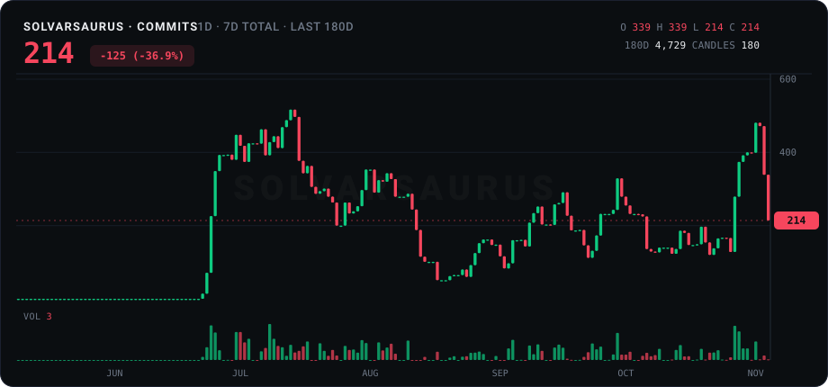

  

  

<b><kbd>&nbsp;&#9654;&nbsp;PRESS&nbsp;START&nbsp;</kbd></b> &nbsp;click to open the profile

 

**Senior Software Engineer** &nbsp;·&nbsp; IoT &nbsp;·&nbsp; Edge AI &nbsp;·&nbsp; Secure backend systems

I design and build systems where software meets the physical world: devices in the field, video and AI at the edge, and the backend services that connect them. I care about clear architecture, tested code, and systems that fail safe. I like hard problems and teams that ship.

**Currently:** preparing for the AWS Certified Solutions Architect exam.

---

### What I do

| Area | In practice |
|------|-------------|
| **System architecture** | Event-driven, edge-to-cloud platforms. Design decisions written down before the code. |
| **Backend and APIs** | Python (FastAPI, asyncio) and Go services, REST and NATS/JetStream messaging, PostgreSQL. |
| **IoT and embedded** | ESP32 / ESP8266 firmware, embedded Linux, serial (RS-232) and wireless device integration. |
| **Applied AI and vision** | Face, vehicle and object recognition at the edge, ONNX deployment, model evaluation and threshold tuning. |
| **Security and reliability** | Access control, tamper-evident audit logs, hardened deployments, LGPD / GDPR data protection. |
| **Cloud and CRM** | AWS cloud services. Salesforce development with Apex and system integrations. |
| **Engineering practice** | Test-driven development, CI/CD quality gates, code review, observability in production. |

### Tech stack

 &nbsp;·&nbsp;  &nbsp;·&nbsp;  &nbsp;·&nbsp;  &nbsp;·&nbsp;  &nbsp;·&nbsp;  &nbsp;·&nbsp;  &nbsp;·&nbsp;  &nbsp;·&nbsp;  &nbsp;·&nbsp;  &nbsp;·&nbsp;  &nbsp;·&nbsp;  &nbsp;·&nbsp;  &nbsp;·&nbsp;  &nbsp;·&nbsp;  &nbsp;·&nbsp; 

### Activity

### Contact

---

Like something I made? 

